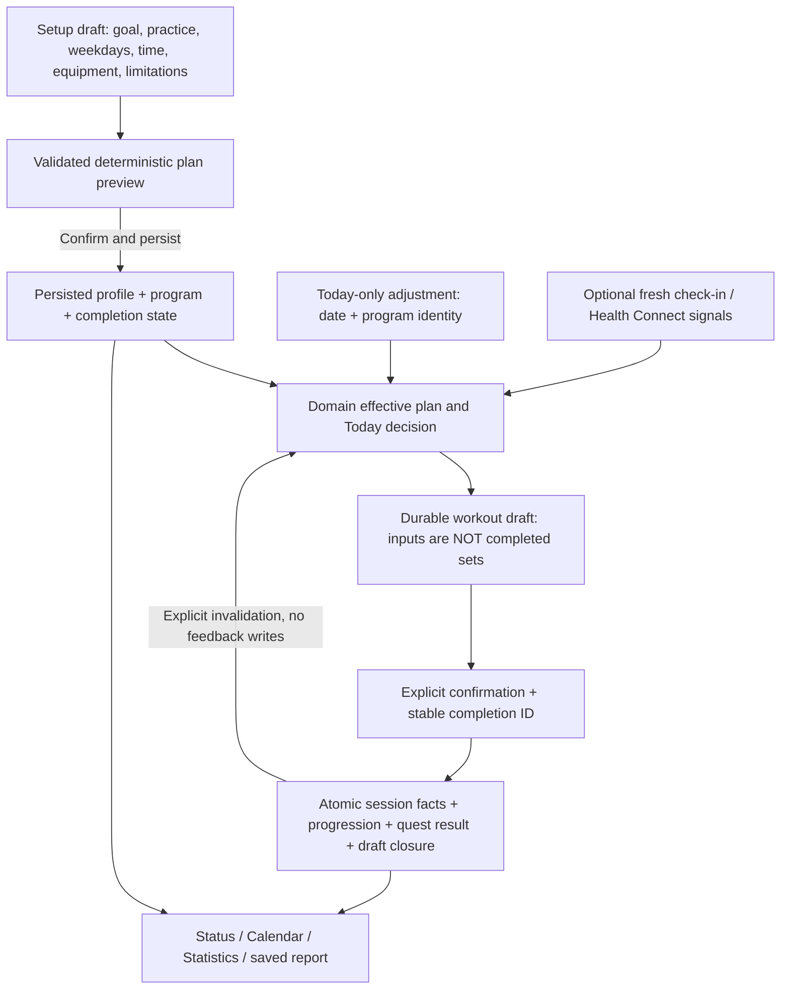

# R05: approved controls and actual data flow

2026-10-15 / D30. Owner accepted the v2 mockups and authorized interaction repairs
and prompt reconciliation. This is a source audit, not proof that the mockups run
on Android. Baseline: HEAD `36d6c480da90438c1b5adaf363de7cfb6986f9d8` plus the existing
uncommitted P02/P03 and design work. Preserve those changes.

Read this document instead of rescanning the application. Follow its source aliases
and the selected task in [QUEUE](../remaster/QUEUE.md). Visual nodes and all 17 screen
keys are in [R05_V2_REVIEW](R05_V2_REVIEW.md). Status appearance remains D29.

## Ownership and flow

Three separate lifetimes: permanent program, today's adjustment, recorded facts.
Compose renders state and dispatches intent; domain owns validation and decisions;
repositories own persistence/transactions; ViewModels expose success, validation,
pending and failure states. Never use a global settings setter for a temporary edit.

## Source aliases

Paths are relative to the repository. Read only aliases relevant to the control.

| Alias | Entry points |
| --- | --- |
| ON | `domain/src/main/java/com/ihor/thesystem/domain/model/Onboarding.kt`; `domain/src/main/java/com/ihor/thesystem/domain/usecase/OnboardingUseCases.kt`; `app/src/main/java/com/ihor/thesystem/feature/onboarding/viewmodel/OnboardingViewModel.kt`; `app/src/main/java/com/ihor/thesystem/feature/onboarding/ui/OnboardingScreen.kt` |
| ENTRY | `app/src/main/java/com/ihor/thesystem/core/navigation/AppEntryViewModel.kt`; `app/src/main/java/com/ihor/thesystem/core/navigation/Routes.kt`; `app/src/main/java/com/ihor/thesystem/core/navigation/AppNavGraph.kt` |
| ST | `app/src/main/java/com/ihor/thesystem/feature/status/viewmodel/StatusViewModel.kt`; `domain/src/main/java/com/ihor/thesystem/domain/usecase/GetStatusScreenDataUseCase.kt`; `domain/src/main/java/com/ihor/thesystem/domain/usecase/DecideTodayWorkoutUseCase.kt`; `app/src/main/java/com/ihor/thesystem/feature/status/ui/StatusScreen.kt` |
| WV | `app/src/main/java/com/ihor/thesystem/feature/status/viewmodel/WorkoutViewModel.kt`; `app/src/main/java/com/ihor/thesystem/feature/status/viewmodel/WorkoutUiState.kt`; `app/src/main/java/com/ihor/thesystem/feature/status/ui/WorkoutDialogHost.kt` |
| DRAFT | `domain/src/main/java/com/ihor/thesystem/domain/model/WorkoutDraft.kt`; `domain/src/main/java/com/ihor/thesystem/domain/usecase/WorkoutDraftUseCases.kt`; `app/src/main/java/com/ihor/thesystem/data/repository_impl/WorkoutDraftRepositoryImpl.kt` |
| FIN | `domain/src/main/java/com/ihor/thesystem/domain/usecase/FinalizeSessionUseCase.kt`; `domain/src/main/java/com/ihor/thesystem/domain/usecase/WorkoutUseCases.kt`; `app/src/main/java/com/ihor/thesystem/data/repository_impl/WorkoutAnalyticsRepositoryImpl.kt` |
| CAL | `app/src/main/java/com/ihor/thesystem/feature/calendar/viewmodel/CalendarViewModel.kt`; `app/src/main/java/com/ihor/thesystem/feature/calendar/ui/CalendarScreen.kt` |
| STAT | `domain/src/main/java/com/ihor/thesystem/domain/usecase/GetStatisticsDataUseCase.kt`; `app/src/main/java/com/ihor/thesystem/feature/statistics/viewmodel/StatisticsViewModel.kt` |
| EQUIP | `domain/src/main/java/com/ihor/thesystem/domain/usecase/EquipmentProfileUseCases.kt`; `domain/src/main/java/com/ihor/thesystem/domain/model/SystemConfig.kt`; equipment/settings handlers in WV |
| TODO | `app/src/main/java/com/ihor/thesystem/feature/status/ui/RpgTodoBlock.kt`; ST task add/toggle/reorder/remove handlers |
| ERR | `app/src/main/java/com/ihor/thesystem/core/ui/UiErrorEffect.kt`; `app/src/main/java/com/ihor/thesystem/core/ui/UiEvent.kt`; ST/WV error producers |

## Control-to-state contract

Rows describe the accepted target. "Missing" is intentional implementation backlog,
not an assertion that Figma clicks persist real data. Owners are stable prompt IDs.

| Frames / controls | Required chain and adjacent consumers | Current evidence / owner |
| --- | --- | --- |
| G: goal, Continue, manual plan | Setup draft -> validated goal -> preview policy -> persisted goal; manual entry retains answers but must not claim a ready auto-plan | ON has goal enum/config mapping, no durable explicit goal or starter schedule. P07/R08 |
| H: recent practice, Back/Continue | Experience/return interval affects conservative starter policy, not RPG level; Back retains answers and invalidates stale preview | ON experience currently changes initial level/XP; no return interval contract. P07 |
| S: frequency, weekday chips, duration | One consistent weekly schedule: selected-day count equals frequency; validation before preview; persist weekday/time meaning; Calendar and Today use the same anchor | Existing 3/4/5 cycleDays are rotation length, NOT weekly frequency. Missing weekly/time contract. P07/P11 |
| E: location, equipment; EW: capacity/unknown, Save/Cancel | Draft equipment -> typed capacity or unknown -> exercise eligibility -> preview; explicit Save commits intended scope, Cancel has no writes | Existing WV saves individual settings immediately; ON invents 24kg dumbbell capacity. Do not reuse that behavior for EW. P07/R27/R09 |
| B/SB: suitability, review answers, manual alternative | Explicit supported/unresolved state -> no unsupported auto-prescription; change answers recomputes preview; manual path never bypasses the safety explanation | No matching domain state. P07; final exercise/safety content needs qualified review in P23/P25, not a medical claim |
| P: edit answers, exercise list, Save plan | Preview corresponds to current draft revision; persist profile/config/program/completion consistently, then navigate Status; retry is idempotent | CompleteOnboarding writes profile/equipment/config then flag, not schedule/templates. Missing transaction/recovery contract. P07/P05/R08 |
| PL: list, technique, replacement, Back | Read current preview/effective plan; exercise IDs stable; help is read-only; replacement has explicit permanent-vs-today scope | Existing exercise catalog/picker paths must be retained. Picker pop-before-save is risky. P13/R27/R09/R11 |
| Status: View plan vs Open workout | Typed action with date/plan identity; first is read-only, second opens/resumes the correct draft; no-plan goes setup, rest does not open a fictitious workout | Current Status primary action only navigates Cycle. P08/R08/R09 |
| L0/L1: weight/reps, add/edit/toggle set, finish | WV input -> durable raw draft -> validation -> explicit completion; completed state can be undone; finish enabled only for valid performed facts | P02/P03 current code covers much of this; focus loss persists but does not complete. R09 preserves it |
| F: Save partial / Continue training | Confirmation captures current draft revision; Cancel never finalizes; confirm revalidates and submits stable completionId once | WV currently finalizes directly, no separate partial-confirm state. P10/R09 |
| R/RD: saved summary, details, return | Show committed sessionId/facts and honest partial/full outcome; details read that exact session; primary returns Status; refresh subscribers without replaying rewards | Current report has sessionId; acknowledge only dismisses dialog. P10/P12/R09 |
| D: Resume / discard / Back | Restore raw inputs + explicit completion + effective-plan identity; destructive discard requires confirmation; navigating away is not discard | P02 existing draft/conflict state; extend to adjustment identity in R27, wire R09 |
| A: time/equipment/replacement for today, Apply/Cancel | Local edit draft -> domain validation -> persisted date-scoped override -> current Today/workout; future program unchanged; completed sets never silently removed | No durable override exists. NEW R27 before reward/UI consumers |
| SE: retry / continue editing | Critical save state stays visible, inputs retained; retry same completionId; committed-but-report-failed opens saved facts instead of writing again | Current generic errors are transient events. Foreground delivery repaired here; persistent failure/retry UX remains R09/P03 |
| Status tasks: add, checkbox, menu, hold/reorder | Explicit standalone add, stable todo ID for toggle/menu, durable order; rename/remove menu needs an actual handler; hold must not steal checkbox/menu taps | Footer previously sent list length as questId, repaired here. Existing remove/reorder retained. Rename/accessibility/row hold contract: R08 |
| Five tabs / Calendar date / Profile settings | Same persisted state across navigation; historical date must survive plan view; global edit invalidates preview and checks active draft; errors visible | Calendar selected date can be reset by Cycle refresh/selectToday. P11/R10/R11; global settings R13 |

## Findings and ownership

| ID | Evidence / consequence | Resolution owner and verification |
| --- | --- | --- |
| DF01 | ON completion does not create a usable program; old cycleDays does not mean days/week | P07: schedule, weekday anchors, rest days, preview revision, atomic/recoverable completion; clean-install + failure/retry tests |
| DF02 | New experience/time/limitations/capacity inputs lack durable contracts; false 24kg default | P07: typed unknowns and policy inputs; backup/schema/tests belong to the task that adds each field |
| DF03 | ST outer sources are player/config/quests/matrix; decision computed inside schedule mapping; WV recommendation reads include snapshots | P09: explicit dependency/invalidation graph; P15 signal refresh; R27 override invalidation; prove updates without restarting screen and without write/collect loops |
| DF04 | No today-only adjustment entity/use case; using global settings would alter future workouts | R27: date + base-plan revision + override + draft consistency, cancel/expiry/conflicts, backup/migration and restore tests |
| DF05 | Finalize marks quest tasks from any completed set per exercise; one set for each exercise can satisfy quest despite unfinished planned sets | P10: define partial/full/reward eligibility explicitly; P12/P17 consume same recorded outcome, not a separate UI heuristic |
| DF06 | Status primary CTA routes only to Cycle; selected Calendar date can be replaced by selectToday | P08 typed entry; P11 date rules; R08/R09/R10/R11 bind actions and back behavior |
| DF07 | Cycle picker saves in picker-scoped VM then pops immediately | P13: source-owned result or acknowledged save before pop, with cancellation/failure tests |
| DF08 | Footer add passes visibleTodos.size into questId branch | Fixed in this audit: parameterless add intent, Status binds standalone add (0); Compose regression tests added, device execution tracked separately |
| DF09 | ST/WV ShowError events had no consumers on relevant screens | Fixed foreground delivery in shared UiErrorEffect (Status/Profile/WorkoutDialogHost); not a durable failure-state solution. R09 owns persistent save/retry UI |
| DF10 | v2 preview 35min/4 exercises differs from approved Status fixture 45min/5; secondary/360 links and shared bindings incomplete | R05 prototype closure: same scenario values without redesigning D29; Android truth comes from P07/P08/R27, not hardcoded mockup numbers |

## Invariants and verification matrix

1. Input edits update only setup/session draft until explicit Save. Back preserves draft;
   changing an upstream answer invalidates downstream preview, with no hidden writes.
2. Unknown weight/capacity/sleep is not zero, a guessed capacity or a readiness score.
   Optional Health Connect is never a first-plan prerequisite. Equipment capacity is
   not evidence of strength. Exercise policy must use only supported catalog metadata.
3. Plan preview, Status, workout and Calendar agree on date, exercises and plan revision.
   No-plan/manual-pending/unresolved states have honest actions, not pretend completion.
4. Routine global plan edits and one-day adjustments are distinct intents. Existing
   completed sets survive; an incompatible change requires explicit conflict handling.
5. Entered reps/weight are not performed sets. Zero completed sets cannot grant rewards.
   Partial completion remains partial in report, quests, Calendar, Statistics and metrics.
6. Commit is once-only. Cancel confirmation writes nothing; repeated taps/retry/process
   restart cannot duplicate logs/rewards. Report data is read by committed sessionId.
7. Add/toggle/edit/delete/reorder tasks updates the same standalone todo records and
   calendar projections; nested legacy tasks remain accessible until explicitly migrated.
8. Every persistent new field includes schema/migration, backup/import defaults and
   readers in its own task. Do not require the owner to rerun an earlier prompt.

| Test journey | Required observation | Owners |
| --- | --- | --- |
| Setup -> Back -> edit days/equipment -> preview -> Save -> restart | No stale preview/duplicates; Status and Calendar show the saved program; completion route stable | P07, R08, P18 |
| Unknown capacity / unsupported equipment / unresolved suitability / no HC | Honest validation and useful supported alternative; no invented prescription | P07, P15, R08 |
| Apply/cancel today adjustment -> change tabs -> restart -> next day | Cancel has no writes; apply shared across current-day consumers; future plan intact; draft conflict visible | R27, P11, R09, P18 |
| Enter -> kill process -> resume -> complete -> uncheck -> partial confirm/cancel | Raw input retained, explicit completion respected, cancellation produces no session | P02 regression, R09, P18 |
| Save fails before commit / fails after commit / retry / double tap | Persistent error where needed, same identity, one session/reward, exact saved report | P03 regression, P10, R09, P18 |
| Finish partial -> Calendar -> Statistics -> beta metrics | Same performed-set count and outcome everywhere, no false fully completed marker | P10, P12, P17, R10, R12, P18 |
| Calendar historical date -> plan -> Back; picker save failure -> Back | Date retained, mutation success acknowledged, no lost selection on pop | P13, R10, R11, P18 |
| Both todo add controls with 0 and 3 existing items | Same standalone-add path, never list count as quest ID | This audit test; R08/P18 real-app persistence coverage |

## Boundaries

This audit implements only DF08 and foreground DF09 wiring. Other rows are explicit
future tasks, not secretly implemented business changes. No prescription/scientific
claim was newly validated here. No device/Room/Figma runtime execution is implied by
source inspection or compile. See [audit evidence](../remaster/evidence/2026-10-15-r05-data-flow.md).
