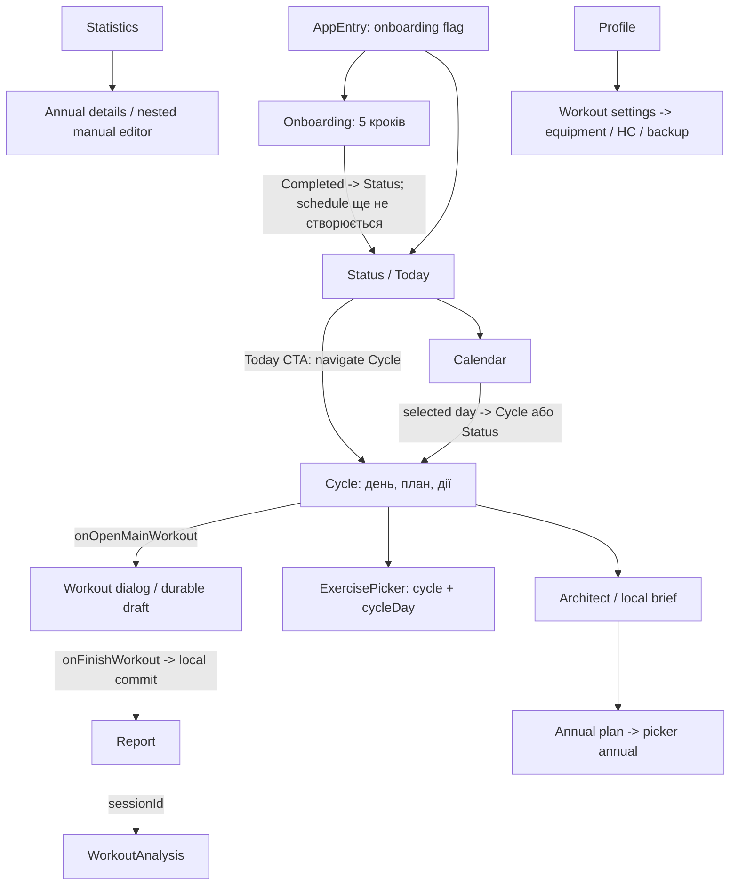

# R02: контракт користувацьких сценаріїв

Версія UX-R02-v1, 2026-10-12. Основа: погоджений [SC-R01-v1 A-D](../remaster/FEATURE_SCOPE.md).
Статично звірено з HEAD `36d6c480da90438c1b5adaf363de7cfb6986f9d8` + поточним P02/P03 dirty tree.
Код, routes та layout не змінені. Немає нових device screenshots або спостережень людей.
Дії й точні джерела: [ACTION_INVENTORY](ACTION_INVENTORY.md); implementation status: [QUEUE](../remaster/QUEUE.md).

## Межі достовірності

2026-10-15/D30 overlay: [R05_DATA_FLOW](R05_DATA_FLOW.md) is the accepted target
control/data contract for setup, today-only edits, logging, partial confirmation and
report navigation. New inputs are pending implementation, not current APIs. J01-J04
and the diagram below remain the historical/current-code baseline where they differ.
R04 Status is accepted D29; R05 v2 visual/content accepted D30; other-tab R06 gates remain.

`current`: прочитаний route/callback/state contract, не доказ його runtime-зручності.
`planned`: бажаний результат відповідної P/R-задачі; не вже реалізований API чи Figma node.
P01/P02 мають свої докази, P03 ще потребує device gate. Решта P07-P17 не стає done через цей документ.
Продуктова послідовність погоджена R01; concrete hierarchy/labels/layout proposals нижче потребують
approval до R04 і внесення у FIGMA_MAP. R03 може переносити чинні foundations без цих змін.

## Поточна навігація

Це схема прочитаних зв'язків. Calendar не передає дату параметром route; Cycle refresh викликає
selectToday, тому відкриття обраної історичної дати потребує виправлення/перевірки UX-R02-G02.
Manual annual editor є вкладеним станом AnnualProgressionDetails, не новим Routes object.
Settings picker має і nested Screen, і окремий Routes.ExercisePicker; обидва entry paths зберігаються.

## J01. Перший запуск -> придатний план

Current: AppEntry чекає startDestination; ObserveAppStartDestinationUseCase читає onboarding completion flag.
Onboarding NAME/GOAL/EQUIPMENT/EXPERIENCE/CYCLE має back/continue, validation та isSaving.
CompleteOnboardingUseCase записує profile/equipment/config/flag, але не створює Schedule.
OnboardingEvent.Completed веде до Status із видаленням onboarding із back stack.

Planned P05/P07, R08: достатні answers -> придатний starter schedule -> конкретний Today або
чесний запланований rest з наступною датою. No-plan має окрему дію завершення налаштування.
Existing completion flag після restore не є достатнім доказом цілісного плану.
Name/goal/equipment/cycle можна виправити через чинні settings; нові параметри ритму — лише
якщо їх погодить P07 contract, не вигаданий шостий крок у R02. HC/login/AI/body metrics не gates.

Acceptance: synthetic clean install і restore fixtures; самостійний придатний план без ручного DB setup;
помилка save лишає answers/retry, не видає фальшивий success. Device proof належить P07/P18.

## J02. Today: що / чому / дія / результат

| Стан | Що і чому | Головна дія / результат | Межа |
| --- | --- | --- | --- |
| Training | План на сьогодні, коротка причина й джерела | Відкрити Cycle/workout, записати виконане | Current enabled CTA завжди navigate Cycle; action semantics доробляє P08/R08 |
| Reduced/deload | Пояснене зменшення навантаження | Виконати дозволений варіант; реальний report | Domain вирішує, Compose не перераховує |
| Recovery/rest | Планова пауза або обмеження | Подивитися наступний план/дозволені дії | Не підштовхувати workout заради XP/streak; P10/P11 |
| Unknown/stale | Яких свіжих сигналів немає | Необов'язковий check-in або базовий план за domain | Manual check-in write UI ще planned P09 |
| No plan | Schedule ще відсутній | Перейти до налаштування usable plan | Не підписувати це як впевнене recovery; P07/P08 |
| Completed | Canonical workout уже записаний | Переглянути результат/наступний крок | Не повторювати completion/reward; P03/P12 |

Current TodayOrderUiModel дає label/enabled/reason; TodayOrderBlock має один onStartWorkout callback.
Це не окремі typed routes для всіх станів. P08/R08 мають узгодити state -> action у ViewModel/mapper.
Результат описує виконане, recovery або пояснену наступну дію; unknown дані не підміняються оцінкою.
No-AI та HC refusal не створюють dead-end. Критичні пояснення повністю доступні зі scrolling.

## J03. Почати / продовжити / відкласти workout

Current: Status CTA -> Cycle; selected cycle day -> onOpenMainWorkout -> MainQuestWorkoutDialog.
Weight/bodyweight/time вводяться через ActiveDayCard, input/focus/completed/add-set callbacks -> WorkoutViewModel.
Technique/info є локальним dialog; setup start/target -> SetupMatrix -> повернення до workout.
Кількість remaining/completed і canFinish йде з loggingSummary; додані підходи не стають completed автоматично.
Закриття workout зберігає draft; discard має окреме підтвердження.

Restore: сумісний draft підхоплюється; несумісний -> WorkoutDraftConflict із keep або discard-and-continue.
Keep не перетворює несумісний draft на новий workout. Не зливати різні дата/plan/exercise sets.
Selected cycle day можна активувати на сьогодні лише окремою явною дією, не через перегляд.

Planned R09/P18: IME/scroll/back, error visibility, source-consistent substitutions і cancel
перевіряються через real VM/NavHost. Клавіатура не ховає completed/finish; focus loss не є completion.
Під час finish повторний tap/cancel не запускає другий save; re-edit/raw input не губиться при failure.

## J04. Finish -> saved report -> наступна дія

Current: isFinishing і loggingSummary.canFinish керують CTA. onFinishWorkout використовує P03
canonical completion і після успіху відкриває WorkoutReport; optional AI failure має локальний report.
Report закривається або відкриває WorkoutAnalysis(sessionId). Відкриття report після process death
не оголошується реалізованим persistence-контрактом без окремого proof.

| Питання користувача | Потрібний зміст |
| --- | --- |
| Що записано? | Completed exercises/sets і частковість; saved лише після commit |
| Чи є прогрес? | Порівняння completed даних або insufficient history, не вигаданий рекорд |
| Що вирішила система? | Короткий local verdict; джерела/обмеження; AI пропозиції відокремлені |
| Що наступного разу? | Погоджена next recommendation/plan або повідомлення, яких даних бракує |
| Save failed? | Збережений input/draft, зрозуміла помилка і retry без duplicate finish |

Для failure UI недостатньо emit UiEvent без споживача: UX-R02-G03. P03 device gate лишається open.
Історія/корекція не замінюється manual new-session logging із sessionId=null: UX-R02-G01.

## J05. Наступний день і повернення після перерви

Current: RefreshOnResume, daily sync/worker, date selection і cycle anchor мають різних owners.
Саме відкриття дня не є commit, виконаним rest або streak event.
Planned P10/P11/P12, R14: один узгоджений day state у Status/Calendar/quest/history, timezone/midnight
та повторний foreground catch-up без duplicate XP/quest. Зміна майбутнього плану не переписує логи.

Повернення: коротко показати актуальний план і причину; добровільний короткий варіант лише коли
domain дозволяє. Зберегти чесні пропуски та історію, без penalty presentation за SC-R01-v1 A.
Немає нового compulsory recovery workout, обов'язкового modal або скидання XP через UI дизайн.

## J06. Calendar -> день / settings / history

Current: місяць +/- -> onMonthChange; cell -> onDateSelected; day CTA -> Cycle або Status;
settings -> CalendarSettings. Calendar читає план і факти, але direct edit/toggle todo в ньому
не підключений: робоче виконання todos зараз у Status. Не малювати фіктивні event callbacks.
Settings template/name/start date/length/repeats/day type/order/today anchor -> onSaveCycle;
Saved event веде back, validation/save error лишає форму, cancel/back не є save.

Planned P10-P12/R10: зберегти date context при поверненні, відрізняти planned/partial/completed/missed/no-data,
історичний день не відкриває сьогоднішній workout мовчки; UX-R02-G02 має окремий сценарій P18.

## J07. Backup і керування даними

Current Profile -> workout settings -> Equipment pane -> SAF export/import. SAF cancel без URI не викликає
write. Import read -> previewBackupImportJson -> pendingImport dialog -> confirm або cancel.
BackupUiState.isBusy захищає preview actions; confirmBackupImport виконує import.
Наявний preview не доводить повного/атомарного restore: P04/P05 ще planned.

Planned P04/P05/R13: preview описує payload/ефект, explicit confirm, validation до mutation,
non-destructive failure, DB/prefs/setup/route узгоджені. Export/write failure не показує success.
Після імпорту потрібний reload потрібних owners, не новий автоматичний onboarding із загубленими даними.
Move backup з вкладеної Equipment pane до видимого Profile data section — hierarchy proposal H05,
збереження event/owner/SAF контракту обов'язкове. Особистий import у R02 не запускали.

## J08. Без permissions / без мережі / без AI

Current HC launch -> onHealthConnectPermissionsChanged -> refresh status; optional sleep data.
Unavailable/denied/revoked/loading показуються чесно. Request не дорівнює granted; не loop prompts.
P15 завершує permission/rationale/revocation handling; R13 зберігає core path без дозволу.

Current local report/Architect brief корисні без Gemini; remote chat/analysis gated availability,
disabled F45/F46 cards мають погоджений hide disposition. WorkoutAnalysis route із report
розглядати окремо від gated Architect module: один disabled entry не доводить відсутність route.
Annual plan є локальним generator, не remote AI. Offline не є global error для локального logging.

Planned P16/R13: no raw exception у copy, короткий local brief і read-only recommendations;
apply проходить domain validation. Live Coach/F42-F43 не розширювати й не просувати в Free MVP.

## Мінімальна матриця станів

| Стан | Чинні носії | Contract до remaster / перевірка |
| --- | --- | --- |
| Load | AppEntry null; UiState.Loading; Onboarding/Calendar/annual flags | Не показувати вигаданий план; loading не дорівнює empty; retry за actual error contract |
| Empty | Empty Cycle/list/history/annual; picker zero results | Контекстна діюча дія setup/add/change-filter; no-plan не rest |
| Error | UiState.Error, validation message, UiEvent.ShowError | Видимий feedback/retry/input preserved; uncollected events є gap G03 |
| Unknown | Today missing data, NO_DATA calendar, no-HC | Джерела/свіжість, без впевненої оцінки; P08/P09/P12 |
| Saving | isSaving/isFinishing/isBusy/isGenerating де вони справді є | Повторні дії disabled, не видавати started coroutine за saved |
| Saved | Onboarding Completed, Calendar Saved, committed report, annual saved message | Успіх лише після commit; atomic aggregate tests у P03/P04/P14 |
| Restore | Draft compatibility, pending backup preview, initial route | Розрізняти draft і backup; P02/P05/P18 device proof |
| Cancel | Pop/back/dismiss/SAF null/preview cancel/draft keep | Немає прихованого save/delete; підтверджений discard окремо |

General flags не стверджуються на кожному екрані: picker має flows без окремого error UiState,
Calendar не має явного errorMessage, Profile non-content зараз показує loading. Не копіювати ці
обмеження як бажаний UX; relevant owners додають state contracts із тестами.

## Пропозиція зрозумілої ієрархії

| ID | Чинна назва/route зберігається | Бажаний пріоритет для макета | Статус |
| --- | --- | --- | --- |
| H01 | Статус / Routes.Status | Today -> одна дія -> прості справи; без окремого progress/details box за D27, дані/інші actions зберегти | Initial Status accepted/D29 after D26-D28, Figma only; alternate states R05/native R08 future |
| H02 | Календар / Routes.Calendar | План і факти за датою, зрозумілий перехід у день/settings | Proposed composition; date semantics P12/R10 |
| H03 | Система / Routes.Cycle | Активний план -> start/resume -> edit/picker; RPG attributes другорядні | Approved A/B, final frame до R04 |
| H04 | Статистика / Routes.Statistics | Реальний weekly proof/history/correction + інформація колишнього Status progress box -> optional annual -> diagnostics | D27 Statistics destination approved; exact design R06/native R12 future |
| H05 | Профіль / Routes.Profile | Identity -> optional metrics -> settings/data/permissions із видимим backup | Proposed layout/location до R04, handlers keep |
| H06 | Помічник / Routes.Architect | Local brief -> working optional tools; F45/F46 hide, chat expansion defer | Approved A/C, final frame до R04 |

Нових Routes, перейменувань вкладок, переміщень у runtime чи web макетів R02 не робить.
H01-H06 є інформаційною пропозицією для R03/R04, не вибраним pixel-perfect макетом.
Перед R04 записати owner approval конкретного hierarchy/frame; нові пропозиції не підміняють його.
R02 можна закрити як статичний contract; його завершення не закриває цей майбутній design gate.

## Незмінні межі implementation

Кожна inventory action отримує equivalent entry/event/state або approved hide лише без втрати даних.
Не переносити decisions у Compose, не видавати generic apply за validated mutation.
Historical editor має explicit sessionId + exerciseId; draft не є history, manual log не correction.
Critical copy/touch/insets/scroll/TalkBack/reduced motion перевіряються P18/P19, не самим MD.
Figma R05/R06 відтворює conceptual states із synthetic data та позначає planned contracts.
Нові знайдені gaps мають IDs/owners у ACTION_INVENTORY; назва задачі не є доказом їх виправлення.
