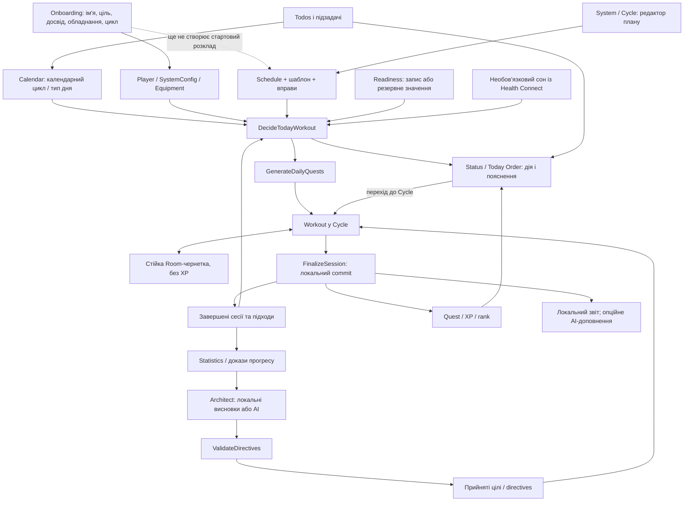

# 02. Логіка, сильні сторони та слабкі місця

## Для чого існує застосунок

Користувацька задача не «вести багато таблиць». Вона така: **зрозуміти, що робити сьогодні, виконати це без зайвої метушні й побачити, що зусилля накопичуються**. Для цього не потрібно бути шанувальником аніме або ігор. Ширша ідея персональної системи сумісна з нинішнім тренувальним ядром, але поточний код ще не є універсальним планувальником усіх сфер життя.

Застосунок поєднує чотири підсистеми:

1. Планування: обладнання, цикл, вправи, календар, тип дня.
2. Виконання: підходи, ваги/повторення/час, чернетка, завершення.
3. Зворотний зв'язок: журнал, порівняння з планом, прогрес, наступні рекомендації.
4. Мотиваційна подача: XP, рівень, ранг, серія, квести, контрольні нормативи. Для ширшої аудиторії цей шар має бути другорядним і зрозумілим без спеціальної термінології.

AI і Health Connect є додатковими джерелами, а не передумовою корисності. Для першої beta така автономність є перевагою: менше дозволів, менше залежності від мережі, простіше зрозуміти, що саме робить продукт.

## Карта взаємодій

Це схема поточного продукту, не нова архітектура. Пунктир показує незавершений очікуваний зв'язок.

План і Calendar overlay сьогодні не є однією таблицею. Відповідно, зміна «сьогодні відпочинок» має узгоджувати кілька споживачів: Today Order, квест, workout, серію та підрахунок пропусків. Ця взаємодія важливіша за вигляд окремої картки. [E03, E07, E12](06-EVIDENCE.md).

Технічний напрям даних: Compose -> ViewModel/UI state -> domain use cases -> repository -> Room/інтеграція. Довідник точкової роботи вже існує: [FEATURE_MAP](../../architecture/FEATURE_MAP.md). Не потрібно щоразу читати весь застосунок.

## Що дають екрани

| Екран | Його корисна роль | Де виникає тертя |
| --- | --- | --- |
| Status | Одна актуальна дія, коротке пояснення, стан дня | Today Order переводить в іншу вкладку; два режими Status вимагають виявлення жесту |
| Calendar | Коли тренуватися, що виконано, які дні змінені | Overlay і Schedule можуть давати різні трактування дня |
| System / Cycle | Вправи, налаштування циклу, виконання тренування | Технічна назва й суміш редактора та щоденного виконання можуть бути незрозумілі новачку |
| Statistics | Доказ змін за реальними записами | Багато агрегатів та оцінок; їхня формула й обмеження не завжди очевидні |
| Profile | Особисті дані, обладнання/налаштування, контроль збереження | Частина налаштувань і backup залежать від великого WorkoutViewModel |
| Architect | Коротко пояснити тренд і наступний крок | Є корисний local brief, але також недоступні картки й кілька видів висновків |
| Annual plan / details | Довгострокові орієнтири та ручне коригування | Висока складність раніше, ніж доведено першу звичку |
| Exercise picker / info | Знайти вправу, зрозуміти виконання, підібрати заміну | Критичні правильний день повернення та зрозумілі одиниці вимірювання |

Це оцінка маршрутів і структури коду. Поточне обрізання тексту, плавність свайпу чи якість конкретної анімації тут не вимірювалися.

## Найсильніші сторони

**Є причина відкривати застосунок до тренування.** Today Order потенційно корисніший за пасивний журнал: він скорочує вибір. Але обіцянка працює лише за наявності готового плану й чесного пояснення.

**Core loop не залежить від AI.** Release-конфігурація вимикає Gemini. Локальні правила й звіт можуть бути нормальним продуктом, а не режимом «усе зламалось без ключа». Це треба зберегти. [E08](06-EVIDENCE.md).

**Є суттєва предметна логіка.** Обладнання, заміни, tracking modes, день циклу, рекомендації, квести та recovery-обмеження значно виходять за межі декоративного прототипу.

**Нові захисти даних рухаються в правильному напрямі.** Є durable draft, унікальний completion ID, транзакція завершення і відділення запису від AI-звіту. Це реальна інженерна цінність, хоча P03 ще не має завершеного device gate. [E05](06-EVIDENCE.md).

**Власна дизайн-система вже існує.** Токени й shared primitives дозволяють полірувати стиль без копіювання ефектів по всіх екранах. Не варто починати їх заново.

**Є дисципліна розробки.** Граф, playbooks, guards, CI, schema export, migration-тести й evidence-файли знижують ризик випадкових правок. Водночас файл тесту або зелений source guard не замінює користувацький сценарій.

## Найважливіші підтверджені розриви

### 1. Початкові відповіді ще не перетворюються на готове тренування

`CompleteOnboardingUseCase` записує player, equipment, config і completed-прапор. Створення Schedule/готових вправ там немає. Seed наповнює каталог, а не програму. Через це користувач може завершити налаштування, але отримати REST через відсутність розкладу і мусити самостійно складати план. [E02](06-EVIDENCE.md).

Ціль onboarding також переважно зводиться до набору `sets/reps`, а досвід задає початковий RPG-рівень. Не варто представляти це як повноцінну персоналізацію програми. Продуктова потреба: відповіді повинні явно впливати на готовий, перевірений стартовий шаблон.

### 2. Резервна оцінка виглядає точнішою, ніж є

За відсутності записів `CalculateReadinessUseCase` починає з 70. `DecideTodayWorkoutUseCase` додає warnings про fallback або попередній день, але `TodayOrderUiMapper` не використовує ці warnings і для STANDARD каже про готовність та відсутність перешкод. Це не виміряні «70% готовності організму». [E03, E04](06-EVIDENCE.md).

Потрібні походження, актуальність і рівень достатності даних. «Немає даних, показуємо базовий план без підвищення» корисніше за псевдоточний індикатор. Ручний readiness save/check-in UI у переглянутих feature paths не підключений.

### 3. REST не має єдиного контракту для всіх споживачів

Decision може повернути REST через Calendar OFF. У `GenerateDailyQuestsUseCase.systemTemplateType()` REST потрапляє в `null`, після чого scheduled workout може все одно створити main quest. Тобто кодовий шлях для суперечності існує. Це потрібно закривати cross-flow тестом, не лише міняти напис на Status. [E07](06-EVIDENCE.md).

Так само слід відрізняти REST від відсутності плану. «Нічого не налаштовано» не є запланованим відновленням.

### 4. Backup ще не можна вважати повним безпечним переносом

Preview/confirmation і transaction уже є. Однак export читає таблиці послідовно без єдиного snapshot transaction, а import використовує `INSERT OR REPLACE` і приймає частини даних за своєю політикою. Конфлікт батьківського запису може мати каскадні наслідки для дочірніх рядків; успішна транзакція сама не гарантує бажаної merge-семантики. [E06](06-EVIDENCE.md), [SQLite REPLACE](https://www.sqlite.org/lang_conflict.html).

Onboarding/preferences не є частиною того самого Room-payload. Android backup виключає БД, але не виключає всі preferences. Це створює сценарій «completed-прапор відновився, повний стан не відновився». Потрібна перевірка restore як цілого продуктового сценарію, а не лише коректності JSON. [Android Auto Backup](https://developer.android.com/identity/data/autobackup).

### 5. Health Connect: вузький дозвіл правильний, завершеність недостатня

Manifest і код уже обмежені сном. Але у перевіреному main manifest немає app-owned rationale activity/alias, потрібних для переходу до пояснення використання даних. Фінально перевіряти ще й merged manifest. [E09](06-EVIDENCE.md), [Health Connect setup](https://developer.android.com/health-and-fitness/health-connect/get-started).

Окремі сценарії для наступної перевірки: ніч, що перетинає північ; перекривні записи різних джерел; порожня історія; відкликаний дозвіл. Поточний код сумує тривалості отриманих sleep records. У цьому аудиті не доведено, що всі ці випадки обробляються правильно.

### 6. Локальні beta-показники ще не доводять утримання

`BetaMetricsAggregator` рахує завершені дати за наявністю будь-якого log і поточним Schedule. Calendar OFF/recovery і історична версія плану не є частиною його контракту. Distribution зберігає рішення за днем, а не повну історію зміни рекомендацій. [E10](06-EVIDENCE.md).

Це корисна локальна діагностика, але не підстава заявляти D7 retention, прийняття рекомендацій або частку людей, яким застосунок допоміг.

### 7. Частина UI додає очікування, але не користь

У `AiModulesBlock` «Корекція циклу» і «План на завтра» мають `enabled=false`, `onClick={}`. Вони створюють образ незавершеного продукту. Річний локальний план розташований у AI-області, що може плутати походження результату. [E08, E13](06-EVIDENCE.md).

Не всі такі речі потрібно доробляти. Частину краще не показувати до появи доведеної потреби. Повний розбір: [корисність функцій](03-FEATURE-VALUE.md).

## Ризики, які не слід видавати за вже відтворені баги

- **P03:** унікальність canonical session є, але повторний виклик ще проходить post-commit report/AI етап. Потрібно довести, що retry не спричиняє небажані повторні зовнішні запити чи зміну наступних цілей. Поточний report також обчислюється з аргументів виклику, не тільки з канонічно збережених sets.
- **Cancellation:** внутрішній `runCatching` для today decision у `FinalizeSessionUseCase` не відокремлює cancellation. Зовнішнє `catch` її відкидає далі, але це не покриває вже поглинуту внутрішню помилку. Потрібен окремий regression test; не вважати загальне твердження evidence про cancellation абсолютним.
- **AI validator:** для невідомого exercise ID немає того самого matrix cap; також треба явно перевірити non-finite значення. Це ризик контракту, не твердження, що AI вже записав небезпечну рекомендацію.
- **Performance:** читання всіх logs у decision є кандидатом на оптимізацію. Нових traces немає, тому точного внеску в startup не оцінено.
- **Складність:** WorkoutViewModel поєднує logging, draft, backup, equipment, editing. Це підвищує площу регресії; не означає, що треба негайно створити нову багатомодульну архітектуру.
- **Річні плани, повнота історії, опівніч, timezone:** у попередньому аудиті є задачі; тут вони не пройшли повторну наскрізну перевірку.
- **Lint:** історичний аудит фіксує failure. У цій сесії lint не перезапускався, тому його актуальний pass/fail невідомий.

## Що змінилося порівняно зі старим аудитом

Не можна просто перенести старий список P0 у новий висновок. У поточному [PROGRESS](../../implementation/PROGRESS.md) P01 і P02 позначені done з evidence, P03 має `implemented_needs_device`. Код містить нові draft/commit механізми. Старі формулювання «чернетки немає» і «finish зовсім не має completion ID» уже неточні.

Водночас жоден із цих статусів не закриває backup, готовий перший план, чесність readiness чи весь release gate.

**Рекомендація щодо готовності:** продовжувати внутрішню розробку; не оголошувати публічну готовність за цим документом. Для beta з довіреними даними спершу потрібні докази безпечного backup/restore, завершення workout та наскрізного першого сценарію. Це критерій довіри, а не вимога мати всі можливі фічі.
